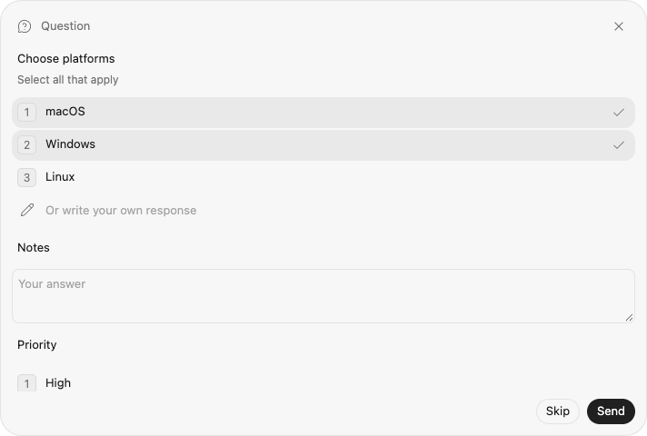
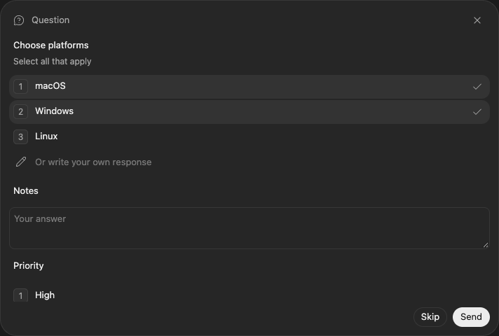

# External Harness multi-select questions

External Harness interactions containing at least one choice field with `multiple: true` or `allowOther: true` use a shared codexhost card. By default the live picker mounts inside the transcript row for that question's Host item (`data-local-conversation-item-target-ids`). Codex Host Settings → Appearance can restore the above-Composer overlay. The complete interaction stays together: any accompanying single-choice and non-secret text fields are answered in the same card. Other interactions, including plain text questions and tool approvals, retain the existing native Desktop projection. Official Codex traffic is unchanged.

## Ownership and answers

Adapters keep emitting the existing `HostQuestionInteraction` contract. No Harness-specific protocol or optional native capability is added by the UI. The card returns declared Host option **values**, not display labels; the Adapter remains responsible for its native response format.

The Host retains shared cards in the same pending-question lifecycle as native questions. Synthetic tool items and their completion remain projected into Desktop. Desktop suppresses its question notification while that conversation is visible, so shared groups send `item/tool/requestUserInput` when a viewer lists a different Thread or reports the asking Thread unobserved (document hidden, or the visible Composer left that Thread). Listing the asking Thread while it is visible resolves that native server request so the Composer returns; leaving again sends a new `requestUserInput`. Answering, skipping, or withdrawing the shared card also resolves that native server request. The Renderer covers leftover native question surfaces — descendants and adjacent request surfaces, not the Composer shell — without HTML-hiding them, and the in-chat or overlay shared card stays the answer UI. Cover updates keep already-covered nodes instead of uncovering first. Native `requestUserInput` unmounts Host chat controls; the Renderer still identifies that Composer so the shared card remounts instead of leaving Desktop's card as the answer UI.

- `codexhost/thread/questions/list` takes `{ threadId, unobserved?: true }` and returns `{ questions }` for the loaded external Thread's active Turn only. `unobserved: true` means this viewer is not showing that Thread; the Host then sends `item/tool/requestUserInput` so Desktop can show its question notification. Listing the asking Thread without `unobserved` dismisses that native request while the card stays pending. Listing a different Thread arms every other pending shared card. It does not resume sessions, start work, or query the official app-server. Unknown/official Threads return an empty list. The pending result stays closed; answered history is not added to this object.
- `codexhost/thread/question-records/list` takes `{ threadId }` and returns `{ records, pendingAnchors }` for the loaded external Thread. Records are in-memory for the loaded Thread: Host close outcomes plus Adapter-supplied native history on `toolExecution.questionRecord`. Secret text is dropped. An older Host answering method-not-found disables records without breaking pending `questions/list`. Official Threads return empty records and anchors.
- `codexhost/thread/question/respond` takes `{ threadId, turnId, interactionId, answers, cancelled? }`. The Host checks the live owner, active Turn, pending interaction and expiry, then validates required answers, declared values, cardinality and duplicate values before calling `interaction.respond`.
- Cancellation must contain no answers. A rejected validation leaves the card pending. Answer delivery uses the existing per-Thread request queue, so it cannot overlap a queued interruption; unrelated Threads remain responsive. Duplicate submissions are rejected after the first delivery. Successful delivery retires the question; ambiguous Adapter exceptions retire it rather than allowing a second write.
- Native withdrawal, Turn completion, Session cleanup and existing Host `expiresAt` handling retire pending cards. Late/replayed responses are rejected. A guessed native response ID cannot answer a shared card.
- Existing shared-Thread routing carries these methods to the Session owner; multiple GUI viewers do not create multiple native questions or permit duplicate answers.
- Authenticated Web clients read the same pending interactions through Client Channel snapshots. Their label-based answers are decoded by the existing question projection and sent through the shared response handler, preserving the same validation and first-writer ownership as Desktop. Shared-question changes invalidate client snapshots without publishing a native single-choice request.

Secret text remains unsupported and fails closed, including in a mixed multi-select group. The fork retains display-only native countdown metadata and acknowledged activity resets through the optional generic Session activity contract. The Harness owns timeout decisions; the card never auto-answers. Plan actions and interactive native preview controls remain unsupported. See the Grok integration document for build dependencies and presentation limits. It does not change what Pi, OMP or another single-choice-only Harness can ask.

## Grok integration

The [Grok Adapter](../harnesses/grok/questions.md) handles native `_x.ai/ask_user_question` requests and maps them into this existing public contract. Multi-select groups and single-choice groups permitting Other use the shared card in both in-chat and overlay placement; other single-choice/text-only groups retain native Desktop cards. Grok owns native answer encoding, cancellation and timeout withdrawal. After reopen, native AskUserQuestion history maps closed questions onto `toolExecution.questionRecord`, including `UserAnswered` selected labels and declined skips. Updating only the card does not add this capability to an older Grok plugin.

## Claude Code integration

The [Claude Adapter](../harnesses/claude-code/claude-code-questions.md) maps native `AskUserQuestion` onto the same Host record. Each native question has `allowOther: true`, so groups use the shared card in both in-chat and overlay placement. After reopen, the record returns from native history: `tool_result` content is the prose `"Which letters?"="Alpha, Beta"`, and structured answers sit on the parent user message as `toolUseResult.answers`. `"User cancelled the Question"` with `is_error` is a skip. JSON tool-result payloads remain understood. Updating only the Host does not restore Claude cards; the Claude plugin must include this mapping.

## Cursor CLI integration

The Cursor Adapter is ACP (`cursor-agent acp`) and already maps blocking `cursor/ask_question` onto a Host Question. `allowMultiple` uses the shared card, so both in-chat and Appearance overlay placement would apply with no Cursor-specific UI. Single-choice groups keep `allowOther: false` and use native Desktop `requestUserInput` cards; the Appearance switch does not move those. Current ACP sessions do not offer the AskQuestion model tool, so the extension is not sent and neither card appears. ACP `session/load` replay also has no answered-question payload, so reopen cannot restore a record from native history. See [Experimental Cursor CLI](../harnesses/cursor/cursor-cli-experimental.md).

## Renderer lifecycle

The versioned Renderer binding chooses one visible external Composer and its existing Host route. Ambiguous, hidden or official Composers show no shared card. The component uses an open Shadow DOM to isolate Desktop CSS resets and keep question inputs out of chat-editor discovery. Its header preserves the interaction title, falling back to “Question” when untitled.

In-chat placement is the default (`localStorage` key `codexhost.harness-question-placement.v1`; a missing key means in-chat). The live picker mounts in that turn's history slot, not as a sibling of the turn in the transcript list. If the Host item row is folded but the turn is still on screen, the live picker uses the same visible history mount as records, and a history slot buried in that folded row moves onto that mount. If that turn is not on screen — another Chat tab, Computer Use covering the transcript, or a virtualized row — a non-covering “Question waiting — Jump” pill sits above the Composer. Jump selects this conversation’s window tab and shows the in-chat card once the row is visible. It does not open the picker on top of the other surface. Overlay mode keeps the live picker before the Composer and closes it after Send or Skip. Switching placement does not drop drafts. Placement is per viewer; the Host pending-question lifecycle does not depend on it.

After Send, Skip, native withdrawal, Host expiry, or Turn/Session close, a read-only record stays in the transcript when an item id is known. By default that record keeps the prompt and the selected answers only (`localStorage` key `codexhost.harness-question-history.v1`; a missing key means selected-only). Each selected choice keeps its original option order id (`1`, `2`, `3`, matching the live picker). Codex Host Settings → Appearance can restore every option in history. Live pickers still show all options until Send or Skip. Outcome labels are Answered, Skipped (you cancelled), Closed by Harness, Expired, and Turn ended. A native timeout pick is never labelled as the user's answer. After reopen, the record returns only when Adapter history supplies the question and its answer. Desktop still folds thinking and tool rows. The record stays visible as a full-width history block during Working, on the working column if no reply exists yet, then on that turn's remaining visible reply (`data-content-search-turn-key`). It does not wait for the turn to finish before appearing, and it does not sit in the narrow tool column beside the reply. The history slot stays inside the turn, never as a sibling of the turn in the transcript list.

Only one refresh is in flight; polling runs every 750 ms and Composer scans also refresh context. Each refresh reads pending `questions/list` then `question-records/list`. Responses are bound to the initiating connection, Host, Thread and Composer. Answer acknowledgements invalidate older in-flight list results. A failed pending-list refresh hides the stale live card. An old Host returning method-not-found disables that method's polling for the connection. A placement error leaves already-mounted records in place.

Selections and text survive refreshes, DOM remounts and chat switching within the Renderer lifetime. The bounded in-memory draft cache holds at most 50 groups, keyed by Host, Thread, Turn and interaction. Answered or withdrawn visible groups are discarded. No draft is written to disk. Controls are disabled while sending; rejected submissions preserve the draft for retry. Disposal removes the card and stops polling.

Both the Host and Renderer must contain this feature. An older Renderer cannot display a new Host's shared cards; there is no silent conversion of a multi-select into single-choice. Update both ends, including remote Hosts. Browser fixtures exercise the component and full binding; they are not installed Desktop or per-Harness acceptance.

## Native question and approval isolation

Native Desktop surfaces marked with `data-codex-composer-request` or `data-codex-composer-request-navigation` own their answer editors and submission actions. A marker on a Composer, its ancestor, or a descendant suspends chat controls for that Composer only. Agent/Model/permission/usage controls do not mount into it; existing controls are disposed and native controls restored when the surface appears. When that surface is the shared question's own `requestUserInput` notifier, the Renderer covers the native card (including a previous-sibling navigation card) without setting HTML `hidden` and without clipping the Composer shell, and the in-chat or overlay shared card stays the answer UI.

Input, Enter, submission and button capture handlers check live ownership before interception, including the interval before the next DOM reconciliation. Late ownership/model responses cannot render into a suspended Composer. Native answer buttons are excluded from send-button discovery and the unlabelled-button fallback. Neither answers nor native disabled states are rewritten.

Adding/removing the markers or inserting/removing a request subtree triggers reconciliation, including inside a rich-text editor. When the surface disappears, normal chat controls are discovered again. Unrelated Composers and ordinary Chat/Orbit surfaces retain their existing behavior. Detection uses these explicit DOM markers, not question text, button labels or a Harness ID; a Desktop version changing the markers needs renewed binding verification.

Browser regressions cover both markers, ancestor/root/descendant placement, same-task native event propagation, dynamic appearance/removal, native button states, delayed ownership replies, unrelated Composers, and shared-card draft restoration. These are fixture tests, not installed Desktop acceptance.

## Browser preview

These screenshots use the real component with synthetic multi-select, text and single-choice fields. They are browser-fixture previews, not installed Desktop screenshots or proof of a specific Harness's support.

## Attribution

The card, isolated styles, polling-controller foundation and native-request marker helpers are adapted from [karlorz/codex-host](https://github.com/karlorz/codex-host/pull/12), revision [`07d8f010`](https://github.com/karlorz/codex-host/tree/07d8f010ae2e969007c611e035e49f3310b73a9d), under the same LGPL-3.0-only license. The fork combines upstream's pending-question lifecycle protections with its shared Other-answer cards and native timer/activity extensions. karlorz is credited as a co-author for the reused upstream implementation.
