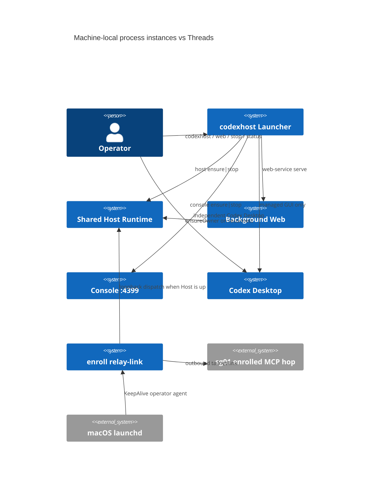

# Instance lifecycle topology

> **Source pin:** `karlorz/codex-host` @ `v0.20.0-0-2-gfb8145cc4` (`fb8145cc`)
> **Analyzed:** `2026-11-18`
> **Skill:** `codebase-architecture-analyze` v0.1.2
> **Output root:** `docs/architecture/instance-lifecycle/`

## Scope

Partial monorepo slice: process **instances** that `codexhost stop`, `codexhost web`, `codexhost status`, Console, and operator LaunchAgents start or leave running.

This extract covers Host, Web, Console, managed Desktop, remote, Broker, product autostart, and operator `enroll relay-link` KeepAlive. It does not re-document Harness Adapter protocol, Mapping Store, or official Codex Thread ownership (see [host-client-channel.md](../host-client-channel.md) and [gui-web-shared-state-design.md](../gui-web-shared-state-design.md)).

## Observed vs inferred

- **Observed** — cited path and symbol.
- **Inferred** — marked as inference.
- **Unknown** — listed under Open questions.

## Stack

- Rust Launcher (`crates/launcher`) owns process supervision, ready records, `codexhost stop` / `web` / `status` / `autostart`.
- Host Runtime (`packages/host-runtime`) owns protocol, enrollment CLI, shared-host `--stop`.
- Web (`packages/web-server`) reconnects to Host and can call `host ensure`.
- Console (`packages/console-server`) is a loopback diagnostic page that can spawn `codexhost stop` and `codexhost web`.
- Platform (`crates/platform`) owns `process_instance(pid, started_at_micros)`, product autostart plist, Broker LaunchAgent, Aqua helper.

## C4 Context (diagram level)

Threads live **inside** Host Runtime. Stopping a process instance interrupts Turns; it does not delete Thread records.

## C4 Container (diagram level)

| Container | Working directory / records | Default port |
| --- | --- | --- |
| Host supervisor + Node | `~/.codexhost/shared-host-ready.json`, `client-hosts/host-*.json` | random loopback |
| Web supervisor + Node | `~/.codexhost/web-service-ready.json` | `127.0.0.1:4400` |
| Console Node | health on loopback; no ready file | `127.0.0.1:4399` |
| Managed Desktop | `~/Library/Application Support/codexhost/desktop-runtime-v1.json` | control port + nonce |
| Product autostart | `~/Library/LaunchAgents/ai.bytepioneer.codexhost.autostart.plist` | none; runs `web --background` at next login |
| Operator enroll agent | `~/Library/LaunchAgents/com.codexhost.enroll-relay-link-muse.plist` | hop `:4401` outbound |
| Broker | `~/Library/LaunchAgents/ai.bytepioneer.codexhost.<id>-broker.plist` | harness-specific |

## Entry points

| Command | Effect |
| --- | --- |
| `codexhost` / `codexhost launch` | Console + managed Desktop + Host/Web ensure |
| `codexhost web` | Host ensure, then Web ensure, open browser |
| `codexhost stop` | Managed GUI, Web, Host, remote, Broker, Console |
| `codexhost status` | Host/Web records + autostart line |
| `codexhost autostart on\|off` | Product login item only |
| `codexhost enroll relay-link` | Foreground link process; no product supervisor |
| `npm stop` | Command-line match across worktrees (`tools/dev-desktop/stop.mjs`) |

## Observed identity split

Two data roots exist on macOS:

1. **Host/Web/Console/enroll stores:** `CODEXHOST_DATA_DIR` or `~/.codexhost` (`crates/launcher/src/startup_record.rs:191-196`).
2. **Managed Desktop launcher descriptor:** `~/Library/Application Support/codexhost/desktop-runtime-v1.json` (`crates/launcher/src/runtime_instance.rs:126-132`).

`codexhost stop` uses (1) for Host/Web/GUI status files and (2) for the Desktop control descriptor. A live process whose ready record no longer matches `pid` + `started_at_micros` is invisible to stop (`crates/platform/src/process_identity.rs:11-15`).

## Thread vs process instance

**Observed** glossary (`docs/project/领域术语表.md:35-37`): a **Thread** belongs to one Harness session. A **Turn** is one execution inside that Thread.

**Observed** process instance: `ProcessIdentity { id, parent_id, started_at_micros }`. Ready files store that pair. Enrollment also issues a **Thread id** (`docs/architecture/client-enrollment.md:28`) that is durable Runtime state, independent of the `enroll relay-link` process (`docs/architecture/client-enrollment.md:125`).

Operators mix these because `ps` shows ChatGPT.app / `codex` app-server / cua_node workers next to `codexhost` binaries, and enrollment carries a Thread id while KeepAlive keeps a separate process alive after Host stop.

## Assumptions and inferences

- **Inferred:** operator KeepAlive on `com.codexhost.enroll-relay-link-muse` is the reconnect loop the CLI itself does not implement (`packages/host-runtime/src/client-enrollment-relay-link.ts` exits on socket close; help text “Runs until SIGINT/SIGTERM”).
- **Inferred:** a Web Node whose supervisor record is missing will call `host ensure` after stop and bring Host back (`packages/desktop-control` HostClientChannel `ensureOwner` on reconnect). Session observation on 2026-11-18 matched Host start at 16:15 after stop claimed idle, then Host exit ~41 s later.

## Open questions

1. Should operator enroll KeepAlive become a product supervisor with install/uninstall and a `codexhost stop` target?
2. Should `codexhost status` list Console, enroll agents, and unmatched PIDs, or stay Host/Web/autostart only?
3. Should `codexhost stop --data` exist for non-default data directories?

## Related extracts

- [00-reimplementation-blueprint.md](00-reimplementation-blueprint.md)
- [02-module-process-instance.md](02-module-process-instance.md)
- [03-module-stop-web-console.md](03-module-stop-web-console.md)
- [04-module-enroll-keepalive.md](04-module-enroll-keepalive.md)
- [05-tech-debt.md](05-tech-debt.md)
