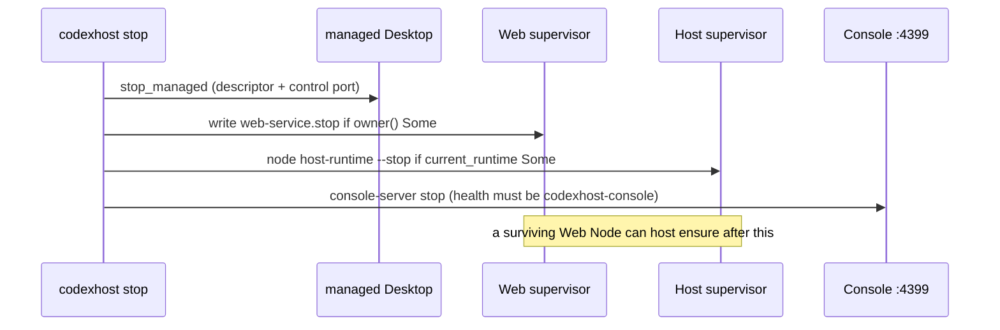

# Module: stop, web, and Console

> **Source pin:** `karlorz/codex-host` @ `v0.20.0-0-2-gfb8145cc4` (`fb8145cc`)
> **Analyzed:** `2026-11-18`
> **Skill:** `codebase-architecture-analyze` v0.1.2
> **Output root:** `docs/architecture/instance-lifecycle/`

## Purpose

Start or stop the machine-local Host/Web/Console/GUI tree while preserving session data and product autostart.

## Interface

### `codexhost web`

Ensures Host, then Web, then prints a login URL. `--background` skips the browser. Default listen `127.0.0.1:4400`. Options `--host/--port/--public-url/--trusted-proxy/--relay` persist (`crates/launcher/src/services.rs` `run`).

`web_service::ensure` always calls `host_service::run("ensure")` first (`crates/launcher/src/web_service.rs:95-97`). Closing the browser does not stop Web.

### `codexhost stop`

`stop_all` (`crates/launcher/src/services.rs:261-345`) stops in order: managed GUI, Web, Host, remote (if `~/.codexhost/remote/manifest.json`), macOS Brokers, Console.

Success with no matching records prints `No codexhost services are running` (`services.rs:339-345`). Spec: do not close independently opened Codex Desktop; do not modify autostart or Tailscale Serve (`openspec/specs/web-background-service/spec.md:74`).

`--data` is accepted for `web` and `stop-for-update` only (`services.rs:420-421`). Plain `stop` uses `CODEXHOST_DATA_DIR` or `~/.codexhost`.

### `codexhost status`

Host running/version from `shared-host-ready.json`, Web from `web-service-ready.json`, Autostart line. Does not list Console, enroll, Broker, or unmatched PIDs (`services.rs:350-381`).

## Stop sequence

## Console stop seam

`stopConsole` returns false unless health `service === "codexhost-console"` (`packages/console-server/src/open.ts:73-75`).

While Console UI `POST /api/stop` is in flight, `/api/shutdown` sets `shutdownRequested` and health becomes `codexhost-console-stopping` (`packages/console-server/src/server.ts:363-365,488-493`). `probeConsole` classifies that as **foreign**, so a later CLI stop reports Console absent.

**Observed 2026-11-18:** PID 57135 listened on `:4399` with health `codexhost-console-stopping`; `console-server.mjs stop` exited 3; SIGTERM released the port.

## Why Web/Host return after stop

**Observed mechanisms:**

1. Web `HostClientChannel.connect` calls `ensureOwner` on each attempt (HostClientChannel reconnect). Launcher always passes `--ch-data` (`web_service.rs` serve argv).
2. `web_service::stop` writes `web-service.stop` only when `owner()` matches pid+start time (`web_service.rs:305-307`). A mismatched record leaves the supervisor's restart loop running.
3. Product autostart at next login runs `web --background` (`crates/platform/src/autostart.rs:150-153`). Stop does not disable it.
4. Console `POST /api/web/open` runs `codexhost web` (`packages/console-server/src/server.ts:514-519`).
5. Remote SSH listener relaunches Host on demand (`tools/dev-desktop/stop.mjs:63-69`).

## `npm stop` vs `codexhost stop`

`npm stop` matches Node command lines for known entrypoints (`tools/dev-desktop/stop-processes.mjs:89-160`) and `web-service serve` / `host serve` supervisors. It does not use ready files. The two tools can disagree on the same machine.

## Depth and deletion test

`stop_all` is an orchestrator of six shallow adapters. Deleting it would re-spread the same order and identity rules into Console, update, and tests. **Leverage** is real (one CLI). **Locality** of “everything stopped” is weak: enroll KeepAlive, stuck Console health, and record-mismatched Web sit outside the interface.
